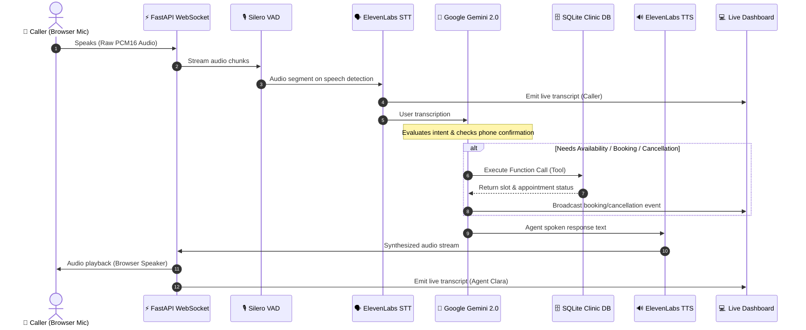

# 🏥 Apex Health — Voice AI Doctor Appointment Assistant

An enterprise-grade, real-time voice AI assistant that books, checks availability for, and cancels doctor appointments over natural telephone conversations. Built with the **Pipecat** framework, **ElevenLabs** for Speech-to-Text & Text-to-Speech, **Google Gemini** for function-calling LLM reasoning, and a high-performance **React + Tailwind** clinical dashboard.

---

## 🌟 Key Capabilities & Highlights

- **Natural Voice Pipeline**: Full-duplex real-time pipeline: `Caller Audio → Silero VAD → ElevenLabs STT → Google Gemini LLM → ElevenLabs TTS → Caller Audio`.
- **Spoken Phone Identification**: Callers are authenticated solely by the phone number they speak out loud (no login, no OTP, no passwords).
- **Mandatory Confirmation Read-Back**: Before executing any booking or cancellation, the agent automatically reads the phone number back to the caller for verbal confirmation.
- **Three Required Function Calling Tools**:
  1. `check_doctor_availability`: Checks open slots for doctors and specialties on any given date.
  2. `book_appointment`: Reserves the chosen slot and generates a unique appointment code (`APT-XXXX`).
  3. `cancel_appointment`: Finds and cancels active bookings linked to the caller's phone, freeing up the slot in real time.
- **Top-Tier Clinical Dashboard**:
  - Real-time phone-style call screen modal with ringing, connected, and ended states.
  - Live audio waveform reacting to microphone and agent speech via Web Audio API.
  - In-call booking confirmation card with instant celebratory visual feedback.
  - Live conversation transcript with speaker roles and timestamps.
  - Real-time synchronized doctors list, available slots, and appointments ledger with animated glow effects on recently modified rows.

---

## 🛠️ Tech Stack & Architecture

| Layer | Technology | Purpose |
| :--- | :--- | :--- |
| **Voice Framework** | [Pipecat AI (Python)](https://github.com/pipecat-ai/pipecat) | Orchestrates real-time audio pipeline, interruption handling, and turn-taking |
| **VAD** | Silero VAD (ONNX) | Low-latency voice activity detection and natural conversational interruptions |
| **STT** | ElevenLabs Speech-to-Text | Real-time speech recognition tuned for conversational phone numbers and names |
| **LLM** | Google Gemini (`gemini-2.0-flash-exp`) | High-speed, low-latency reasoning and function calling with free tier quota |
| **TTS** | ElevenLabs Text-to-Speech | Ultra-natural, empathetic clinical receptionist voice (Rachel - `21m00Tcm4TlvDq8ikWAM`) |
| **Backend & WS** | FastAPI + WebSockets | REST API and bidirectional PCM16 audio & JSON event streaming |
| **Database** | SQLite | Normalized relational database tracking doctors, slots, and appointments |
| **Frontend** | React 19 + TypeScript + Vite + Tailwind CSS | Clinical dashboard with responsive phone modal, waveform visualizer & multi-tab sync |

---

## 📐 Voice Pipeline Flow



---

## 🚀 Quickstart Guide

### Prerequisites
- **Python 3.10+** (Tested on Python 3.12)
- **Node.js 18+** (Tested on Node.js v20)
- API Keys:
  - **Google Gemini API Key** (Free quota at [Google AI Studio](https://aistudio.google.com/))
  - **ElevenLabs API Key** ([ElevenLabs](https://elevenlabs.io/))

---

### Step 1: Clone Repository & Configure Environment

```bash
git clone <your-github-repo-url>
cd NexovAI

# Copy environment template
cp .env.example .env
```

Open `.env` and fill in your API keys:
```ini
GEMINI_API_KEY=your_gemini_api_key_here
GEMINI_MODEL=gemini-2.0-flash-exp

ELEVENLABS_API_KEY=your_elevenlabs_api_key_here
ELEVENLABS_VOICE_ID=21m00Tcm4TlvDq8ikWAM
ELEVENLABS_MODEL_ID=eleven_turbo_v2_5

HOST=127.0.0.1
PORT=8000
```

---

### Step 2: Start the Backend (FastAPI + Pipecat)

```bash
# Optional: create virtual environment
python -m venv venv
# Windows:
venv\Scripts\activate
# macOS/Linux:
source venv/bin/activate

# Install dependencies
pip install -r backend/requirements.txt

# Run the backend server
python backend/run.py
```
*Backend will be running on `http://127.0.0.1:8000` (API documentation at `http://127.0.0.1:8000/docs`).*

---

### Step 3: Start the Frontend Dashboard (React + Vite)

In a new terminal window:
```bash
cd frontend
npm install
npm run dev
```
*Frontend will be running on `http://localhost:5173`.*

---

## 🧪 Testing the Complete Booking Flow (For Video Recording)

Follow this step-by-step script to demonstrate the full workflow:

1. **Open the Dashboard**: Visit `http://localhost:5173`.
2. **Click "Start Voice Call"**:
   - The phone-style call interface appears.
   - You will hear the realistic phone ringing tone.
   - The status transitions to **Connected**, and Clara greets you:
     > *"Hello! Thank you for calling Apex Health Medical Center. My name is Clara. How can I help you today?"*
3. **Check Availability**:
   - Speak: *"I'd like to check Dr. Sarah Jenkins' availability tomorrow."*
   - Clara checks the database and lists available slots (e.g. 09:00 AM, 11:45 AM, 02:00 PM).
4. **Provide Phone Number**:
   - Speak: *"Let's book the 11:45 AM slot. My phone number is 987-654-3210."*
5. **Confirmation Read-Back (Mandatory Rule)**:
   - Clara reads back: *"Just to make sure I have that right, your phone number is 9 8 7, 6 5 4, 3 2 1 0, is that correct?"*
   - Speak: *"Yes, that is correct."*
6. **Booking Confirmation**:
   - Clara books the slot, announces the confirmation code (e.g. `APT-1042`), and the in-phone confirmation card pops up.
   - Confetti celebrates on the screen, and the new appointment row in the **Appointments Ledger** glows with an emerald highlight!
7. **Cancel an Appointment (Bonus Demo)**:
   - Speak: *"Actually, I also need to cancel an appointment under phone number 555-123-4567."*
   - Clara confirms and releases the slot, updating the ledger in real-time.
8. **End Call**:
   - Click the red **End Call** button. Hear the end chime.

---

## 🛡️ Edge Cases & Safety Guardrails

- **Phone Number Normalization**: Cleans whitespace, dashes, country code prefixes (e.g., `+1 (555) 234-5678` → `5552345678`).
- **Interruption Support**: Powered by Silero VAD, if the caller begins speaking while Clara is talking, the pipeline interrupts speech and listens.
- **Slot Collision Prevention**: Atomically toggles `is_booked = 1` in SQLite to prevent double-booking.
- **Slot Release on Cancellation**: When an appointment is cancelled, the doctor's slot is immediately unlocked (`is_booked = 0`) for other patients.
- **Interactive Spoken Chips & Text Input**: Reviewers can speak into their microphone or use quick suggestions/typing in case their microphone is muted or in noisy environments.

---

## 📁 Repository Structure

```
NexovAI/
├── backend/
│   ├── app/
│   │   ├── config.py              # Configuration and environment variables
│   │   ├── database.py            # SQLite schema initialization and connection manager
│   │   ├── seed_data.py           # Preloaded doctors, specialties, and open slots
│   │   ├── appointment_service.py # Core business logic for 3 required tools
│   │   ├── pipecat_pipeline.py    # Pipecat voice pipeline (STT, LLM, TTS, VAD)
│   │   └── main.py                # FastAPI REST API and WebSocket bridge
│   ├── tests/
│   │   ├── test_services.py       # Unit tests for booking, cancellation, phone validation
│   │   └── test_e2e.py            # Integration test suite for API endpoints
│   ├── requirements.txt           # Python dependency specifications
│   └── run.py                     # Entry point to launch the backend server
├── frontend/
│   ├── src/
│   │   ├── components/
│   │   │   ├── Header.tsx         # Top bar with health badges and start call button
│   │   │   ├── StatsOverview.tsx  # Metrics cards (active doctors, open slots, latency)
│   │   │   ├── DoctorsList.tsx    # Doctors directory with interactive slot chips
│   │   │   ├── AppointmentsTable.tsx # Ledger with search, filter, and row glow animation
│   │   │   ├── PhoneCallModal.tsx # Phone-style call screen with in-call transcript & card
│   │   │   ├── AudioWaveform.tsx  # HTML5 Canvas real-time audio visualizer
│   │   │   └── LiveTranscript.tsx # Main dashboard conversation history panel
│   │   ├── hooks/
│   │   │   ├── useVoiceCall.ts    # Web Audio API & WebSocket audio streaming engine
│   │   │   └── useSoundEffects.ts # Synthesized telephone ringing and end-call chimes
│   │   ├── services/
│   │   │   └── api.ts             # REST client for backend communication
│   │   ├── types.ts               # Shared TypeScript data models
│   │   ├── App.tsx                # Main application container
│   │   └── index.css              # Custom animations and scrollbars
│   ├── package.json
│   ├── vite.config.ts
│   └── tsconfig.json
├── .env.example                   # Clean template for environment keys
├── .gitignore
├── PIPELINE_DESCRIPTION.md        # Honest pipeline summary in own words
└── README.md                      # Complete documentation
```

---

## ⚖️ License

Built for SDE Intern / Forward Deployed Engineer (FDE) Round 1 Assignment. MIT License.
